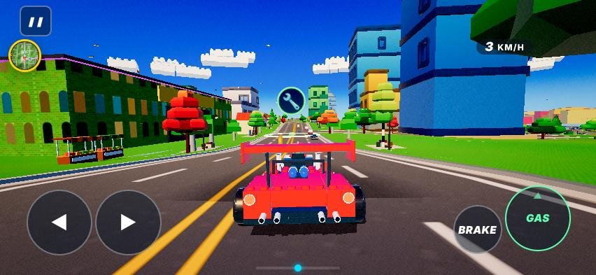
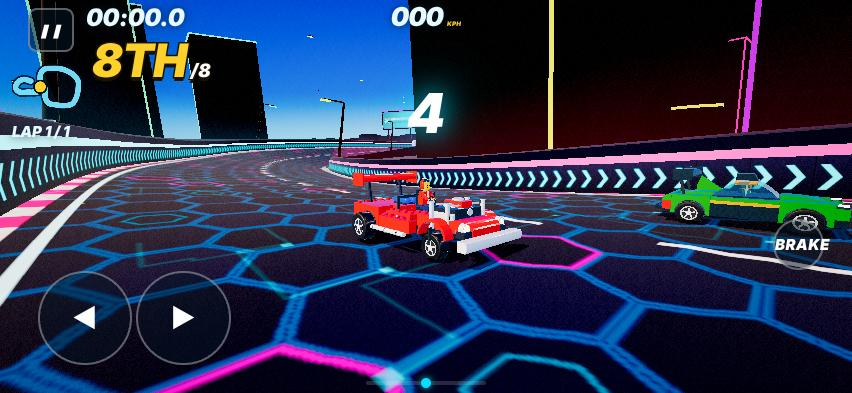
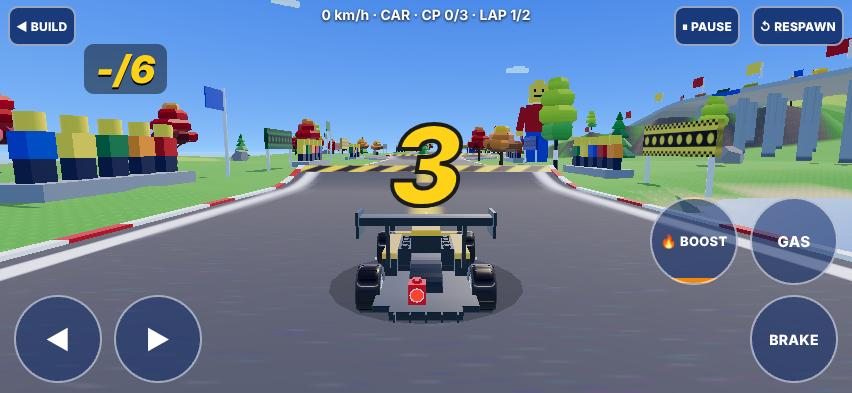

# One game, not three: free roam, races and the builder (design lane onegame-r31c, 2026-10-31)

Alex, 31 Oct: "The races and the city seem like 2 seperate games they don't communicate well, the race builder is even worse like a seperate game not taking the libraries from either free roam or races".

He is right, and the code shows why. There are **three driving games in one page**: free roam (plus city races), Race Mode (the spline tracks) and the builder (BX). They have three physics models, three cameras, three HUDs and two input paths. Only the builder has its own scene, sky, lights, renderer path and save. This doc measures the split, then plans 6 lanes that bring the modes onto one core, each lane behind a flag.

Measured on the BUILT page `out/og31` (trunk 2d9320c, page 3,449,841 B) with the phone profile (iPhone UA, 852x393 touch, SwiftShader). Recipe: `docs/shots/onegame/shots.js`; numbers: `docs/shots/onegame/m.json`.

---

## 1. Audit

### 1a. Who owns what (from the code)

| layer | Free roam + city races (`state 'roam'`) | Race Mode, spline tracks (`state 'race'`) | Builder BX (`BX.on`, lazy chunk `98b2+98fs+98r3e`) |
|---|---|---|---|
| shell / loop | `setupRace(ROAMCFG)` + `hubEnter` (70_roam_world), main `frame()` (72) | `setupRace(cfg)` → `loadTrack` (20/30_race2), same `frame()` | **own**: `frame` wrapped, `BX_tick` runs instead of the game loop (98b2:535) |
| car mesh | `makeShip(team)` → `shipMesh` + `GB_attach` (garage build) | the same `makeShip` → `shipMesh` | `BX_car` → `shipMesh(TEAMS[teamIdx])` **without the garage loadout path of makeShip**, rescaled to 4.3 m, `BX_noFlat`; rivals use `BX_rideMesh` (**copy** of BX_car) |
| physics | `roamStep` (71): 2D world x/z/heading + `groundAt` | `physPlayer` (30_race2:79): distance + lateral offset on the spline (`frameAt`) | **own** `BX_step` (98b2:355): 4 wheel rays on piece meshes, constants top 34 m/s on pieces / 27 off / 20 boat, acc 22, grip 11 / 6.5. **Ignores car stats** |
| top speed, same car "Kronos Finanz" | **40.7 m/s** (`RO.top`, 146 km/h) | **61.1 m/s** (`pl.stats.top`, 220 km/h) | **34 m/s** (122 km/h), any car |
| camera | `roamCam` (71:300, `RCAM` presets) + SKC chase layer (98sc_stkcam, SuperTuxKart port); FOV 66 | `updateCam` (30_race3); FOV 62, raised, offset | **own** `BX_camDrive` (98b2:424), own `PerspectiveCamera(55)`; FOV 55 |
| HUD | `roamHud` (71:342) in `#roam`: minimap, km/h pill, GAS/BRAKE | `updHud` (40) in `#hud`: place, lap, KPH, timer, BRAKE only | **own** `BX_hud` in `#bx`: one text line, own BOOST/GAS/BRAKE, BUILD/PAUSE/RESPAWN; hides every other element (`body.bxOn>*:not(#c):not(#bx)`) |
| input | `ctlPlayer()` (30_race2:46): keys `K`, touch pad, tilt, gamepad | the same `ctlPlayer()` | **own** `BX_input` (98b2:440): `BX.keys` + `BX.tc` touch buttons; no gamepad or tilt |
| sky / light / materials | city sky + brick clouds (97_art ART), `applyMood`, hub lights, glossy (98gc), composer bloom/grade | **separate world** `WORLD` (neon Frankfurt / Athens race world, 20_race_world), `applyMood(cfg.mood)`, same composer | **own** `BX_scene` (98b2): own shader sky sphere, own Fog, Hemisphere + Directional sun with a 2048 shadow map, `BX_mats`; drawn with `renderer.render(BX.sc,cam)`, **bypassing the composer** (no bloom or grade) |
| props / track pieces | Kenney city (`kmGeo`, 51), lz biomes (60), A2/AS assets, race dress `RDS` kerbs/barriers/gantry (98rd) for city races | track builder `buildRoad` + hazards `AHZ`, OPN open ribbons (98ro), items R15 | **own** `BX_geo` pieces, `BX_trees`, `BX_bld`, `BX_pillars`, `BX_landmark`, FS set pieces; **0 references** to kmGeo/kmMat/LD_geo/GB_brickGeo/ART/A2/RDS/OPN (grep) |
| audio | `AU` engine/scrape + `MUS_mode` music per mode | the same `AU` + music | `AU.sfx` only: no engine sound, no music switch |
| save / rewards | `store` slot `mho_slot`, `roamSavePos`, XP `addXP`, coins | the same store, `award`, career XP (22 `addXP/store.set/award` calls in 30_race3) | **own** raw `localStorage 'bx_tracks'` outside the slot system; **0** XP/coin/store calls; a builder race gives nothing |

Own copies instead of a shared one (the list a refactor must remove):
- **Builder**: scene, sky, fog, lights, shadow setup, render call, loop (`frame` wrap), physics (`BX_step`), camera (`BX_camDrive`), HUD (`BX_hud`, `#bx` CSS), input (`BX_input`, `BX.tc`), rival mesh (`BX_rideMesh`), rival AI (`BX_raceTick`), race results (`BX_raceResults`), props (`BX_trees/BX_bld`), save (`bx_tracks`).
- **Race Mode**: physics (`physPlayer` vs `roamStep`), camera (`updateCam` vs `roamCam`/SKC), HUD (`updHud` vs `roamHud`), world (`loadTrack` WORLD vs `buildHub`).
- **Shared already** (keep): `makeShip/shipMesh/GB_attach` (roam + race), `ctlPlayer` (roam + race), `AU`, `store`, composer, `setupRace` as the entry for roam and race.

### 1b. The same car in all three modes (phone profile, 852x393)

| roam | Race Mode (Grand Prix) | builder (CLIFF RUN) |
|---|---|---|
|  |  |  |

What I see (same team, same session):
- **Look**: three different cars. Roam: red hot-rod with a big wing, sunny LEGO city, brick clouds, deep blue sky. Race Mode: a red kart with a minifig on a **neon night** hex-grid world. Nothing there says "Frankfurt in daylight". Builder: a **black** car on a flat pastel valley with a gradient sky and no bloom. The three skies and palettes do not match.
- **Handling**: top speed 146 / 220 / 122 km/h. Three physics models, so the same input gives three different cars. The builder ignores the car's stats completely.
- **HUD**: three styles. Roam: minimap + "3 KM/H" pill. Race: italic "8TH/8", "000 KPH", timer, "LAP 1/1". Builder: one plain text line "0 km/h · CAR · CP 0/3 · LAP 1/2" and a "-/6" place box. Fonts, sizes and corners all differ.
- **Camera**: FOV 66 / 62 / 55. Roam sits low and behind. Race sits high and off to the side. Builder sits close and tight. Each mode feels like a different game within one second.
- **Controls**: roam has round GAS + BRAKE. Race has **no GAS button** (auto-gas) and a BRAKE that overlaps a rival car. Builder has three stacked square-ish BOOST / GAS / BRAKE plus top buttons. The thumb positions are different in every mode.

---

## 2. Player flow today (measured / counted from the code)

| from → to | how | taps | wait (lab) | state kept? |
|---|---|---|---|---|
| boot → city | `?test=fra` page | 0 | **40.5 s** to `__tq.ready` | — |
| city → city race (duel / sprint / event) | drive to the marker, card | 1 | ~0 s, same world (`tkStart`, `chStart`) | car and position kept ✅. This is the one part that already feels like 2K |
| city → Race Mode race | ❚❚ → MENU → RACE → track → START RACE | **5** | **7.9 s** (`__rm.open` → countdown) | `exitRoam` saves the position. The city is hidden (`hubLeave`), not freed, and a second world is built (`loadTrack`) |
| Race Mode → city | results → MENU → FREE ROAM, or quit with `RO.fromRoam` → `enterRoam(RO.lastMark)` | 1-3 | the city rebuild is skipped (`RO.built`) | back at the last **marker**, not the exact spot, unless the race was launched from roam |
| city → builder | ❚❚ → MENU → 🏗 TRACK BUILDER (home footer) → LOAD → track → DRIVE | **5-6** | 0.8 s once the chunk is in | the city stays in memory, hidden by CSS. The builder car is a different car |
| builder → city | ◀ BUILD → close → menu (shot 4: lands on CHOOSE TRACK) → FREE ROAM | 3-4 | — | builder races give **no** XP or coins. Tracks are saved outside the save slot |
| build → drive it | DRIVE in the builder | 1 | instant | ✅ (builder only). A build can never be driven in the city or in Race Mode as a race with your car |

LEGO 2K Drive (refs `ref2k_any_freeroam_vista_01`, `ref2k_any_race_street_01`, `ref2k_any_race_shortcut_01` in docs/shots/library): races start **from the open world** (drive into the race marker, one confirm). The world style, car, handling, camera and HUD carry straight into the race. After the race you are back where you started. A build is driven at once with the same car feel. Our gap: 5 taps + 7.9 s + a world change for a Race Mode race, and 5-6 taps into a builder that does not use our car. In 2K both are 1 tap and the same game.

---

## 3. Target structure: one core, three thin modes

Organisation idea (rule 19, from docs/wiki/learn/cuphead-structure.md, idea only, no Cuphead code read or copied):
- "Scene per level (Loading, Tutorial, Win): a clean split between the level and the shell around it."
- "A small state machine per mode (ground / jump / crouch) instead of flags."

```
CORE (one copy, used by every mode)
  CAR      makeShip/shipMesh/GB_attach + garage loadout + stats (top, acc, grip from carStat / GB_mods)
  DRIVE    one handling model: roamStep's tyre/yaw feel, with a "surface provider" (city ground, spline frame, builder piece rays)
  CAM      roamCam + SKC chase (one FOV/distance table, per-mode offsets only)
  HUD      one HUD kit: speed pill, place, lap, timer, boost meter, minimap slot (same font, same safe-area layout)
  INPUT    ctlPlayer (keys, touch, tilt, gamepad) + the one #touch control set
  LOOK     sky + brick clouds + applyMood + composer + glossy/kmMat materials
  PIECES   one piece library: RDS kerbs/barriers/gantry, BX track pieces, city props (A2/AS), FS set pieces
  SAVE     store slot: XP, coins, tracks
MODES (thin, each a small state machine with enter / update / exit, registered in MODE)
  roam     enter: hubEnter + spawn at saved pos;  update: traffic, quests;  exit: save pos
  race     enter: course (city corridor OR spline world OR builder track) + grid;  update: laps, rivals, items;  exit: rewards → back to the city spot
  builder  enter: edit view (BX edit UI, grid, brushes);  update: edit tools;  exit: save log;  "DRIVE" = race mode with the builder course
```

What each mode must **stop owning**:
- **builder**: `BX_scene` sky/fog/lights and the direct `renderer.render` (use LOOK + composer), `BX_step` (use DRIVE with a piece-ray surface), `BX_camDrive` (CAM), `BX_hud` and the `#bx` drive buttons (HUD + INPUT), `BX_input`, `BX_car`/`BX_rideMesh` (CAR), `BX_raceTick`/`BX_raceResults` (race mode), `bx_tracks` raw localStorage (SAVE), the `frame` wrap (MODE loop). The builder keeps only the **edit** tools: grid, pieces, brushes, log, undo.
- **race (spline)**: `updateCam` (CAM), `updHud` as a separate skin (HUD kit). `physPlayer` stays as the surface provider for spline coordinates, but tyre/yaw response comes from DRIVE.
- **roam**: `roamHud` becomes the HUD kit's roam layout, not a private HUD. Quests stay in roam.
- **all**: `state` strings + `BX.on` + `RO.on` + `RO.fromRoam` flags → one `MODE.cur` with enter/exit. A return point `MODE.back={mode:'roam',x,z,h}` is set on every exit from roam.

---

## 4. Steps (6 lanes, one deliverable each, each behind a flag that defaults OFF until its GO passes)

GO style: `src/99c_checklist.js` state asserts, no graphics, phone profile, one pass line each. Numbers are measured against today (§1, §2).

**S1 — The builder drives YOUR car (player-visible first). OPUS, 90 min. Flag `?og1=1` / `OD_FLAG.og1`.**
In the builder's DRIVE: the player car is `makeShip(TEAMS[teamIdx])` with the garage loadout (same mesh as roam). Top speed, acceleration and grip come from that car's stats (roam values, × the piece-grip factor). The camera uses the roam `RCAM.chase` + SKC numbers. The controls are the shared `#touch` + `ctlPlayer`, so the builder's own GAS/BRAKE/BOOST go away.
GO `onegame/builder-car`: builder car mesh child count and bbox equal roam's (±5 %); BX top speed = `RO.top` ±5 % (today 34 vs 40.7); camera FOV = roam FOV ±2° (today 55 vs 66); `#touch` visible and `#bx` has 0 drive buttons; 0 page errors. Alex feels it at once: open the builder, press DRIVE, and it is his car with his handling.

**S2 — Races start from the city and bring you back. SONNET, 60 min. Flag `og2`.**
Every Race Mode race (Grand Prix … World rivals) gets a city marker (reuse the event/sprint marker and card code from 70/98tk). One tap on the card starts it. On finish or quit, `MODE.back` returns you to the exact spot and heading, without a menu.
GO `onegame/race-roundtrip`: taps city→race ≤ 2 (today 5); race end → driving in the city ≤ 1 tap and ≤ 3 s (lab); position after the return within 5 m and 0.2 rad of the start; `RO.built` reused (no hub rebuild); 0 page errors.

**S3 — One HUD kit for all modes. SONNET, 60 min. Flag `og3`.**
One HUD module: speed pill, place, lap, timer, boost meter and minimap slot, in the same font and safe-area layout. Roam, Race Mode and the builder's DRIVE all use it (`roamHud`/`updHud`/`BX_hud` become layouts).
GO `onegame/hud`: in all 3 modes the same element ids are visible; every HUD text ≥ 12 px; 0 HUD rects overlap the touch controls (852x393 and portrait); a GAS button is present in all 3 modes, or absent in all 3 (today roam yes, race no, builder yes).

**S4 — One look: same sky, light and materials. OPUS, 90 min. Flag `og4`. Visual lane: refs `ref2k_any_freeroam_vista_01` + `ref2k_any_race_street_01`.**
The builder renders through the composer with the shared sky, brick clouds and `applyMood('brick')`, and its own sky sphere, fog and lights go. Race Mode spline tracks default to the daytime LEGO mood, the same as the city (neon becomes a night mood choice).
GO `onegame/look`: the sky uniform/colour and mood id are the same in all 3 modes; `BX.sc` has no own sky mesh or own lights; builder frames go through `composer.render` (count > 0, direct `renderer.render(BX.sc…)` count 0). Shots: 3 × 852x393 side by side with the refs; mean sky hue in the top 20 % within 10° across the modes.

**S5 — Mode state machine (the backbone). OPUS, 90 min. Flag `og5`.**
`MODE = {roam, race, builder}`, each with `enter(arg)`, `update(dt)`, `exit()`. `MODE.go(name,arg)` is the only way to switch. It replaces the `frame` wrap in 98b2, the `RO.fromRoam`/`BX.on` flags and the ad-hoc `toMenu` paths. The builder's DRIVE becomes `MODE.go('race',{course:builderTrack})`. Builder races then give XP and coins through the normal `award` path, and tracks are saved in the store slot.
GO `onegame/modes`: 20 random switches roam↔race↔builder end in a valid state with 0 page errors; after each `exit()` 0 meshes of that mode remain in the scene; a builder race adds XP > 0; `bx_tracks` migrated into the slot (old key read once).

**S6 — One piece library, and builds you can race in the city. OPUS, 90 min. Flag `og6`.**
Builder track pieces, city-race dressing (`RDS` kerbs, barriers, gantry, flags) and city props (A2/AS, Kenney) come from one `PIECES` table. The builder places RDS barriers and city props. A saved build can be raced from a city marker (as in S2) on a flat lot, and it shows in the race menu as a normal race.
GO `onegame/pieces`: builder pieces with `PIECES` ids ≥ 90 %; `BX_trees/BX_bld` replaced (0 own prop geometries); a saved build starts from a city marker and finishes with the bot; page size change ≤ +20 KB (the builder chunk shrinks as copies are deleted).

Order: S1 → S2 → S3 (visible every day) → S5 (backbone, makes S4/S6 cheap) → S4 → S6. Two lanes per target rule: if S1 misses twice, stop and redesign.

---

## 5. Risks and mitigations

| risk | today | what could go wrong | mitigation |
|---|---|---|---|
| **Boot time** (36 s bar) | 40.5 s to ready on this lab run (SwiftShader, test page; the gate uses its own profile) | a shared core that pulls builder or race code into the boot path | the core is made of existing eager modules (`makeShip`, `ctlPlayer`, `roamCam`, composer), so nothing new loads at boot. The builder edit UI stays a lazy `xc/` chunk; race-from-marker loads the spline world only on the tap. GO `p17` / `ios-reveal` before and after each lane |
| **Memory** (iPhone 700 MB cap) | Race Mode builds `WORLD` while the city is only hidden (`hubLeave`); the builder adds its own terrain, scene and a 2048 shadow map with the city still resident | S2's round trip keeps both worlds resident on purpose (no rebuild) | S2 uses the existing compaction (98pc / 98mf) on the hidden hub: textures stay, far chunks are freed. S4 removes the builder's own shadow map and lights (shared sun, 1024 on phone). S5's `exit()` must free mode meshes (GO asserts 0 left). Measure `qa_mem` peak per lane: ≤ +30 MB vs today |
| **Size** (page < 3.5e6 B) | **3,449,841 B: 50 KB of headroom** | new HUD kit / MODE code pushes the page over the cap | new code goes in lazy chunks or replaces copies in the same lane: S1/S3/S4 *delete* builder copies (BX_step, BX_camDrive, BX_hud, BX_scene ≈ 15-25 KB of the 122 KB chunk). Each lane reports the page size; a lane that adds more than 5 KB eager must delete at least as much |
| feel regressions | race physics tuned on `physPlayer`, roam on `roamStep` | one DRIVE model changes race feel | S1 applies roam handling only to the builder; race physics keeps its surface provider and only shares the tyre/yaw constants after S5, behind its own flag, with the `feel/handling` GO and Alex's play |
| flag pile-up | rule 11: max 1 day OFF | 6 flags open at once | one lane at a time (cost rule); a preview with the flag ON the same day; ship ON or delete within 1 day |
