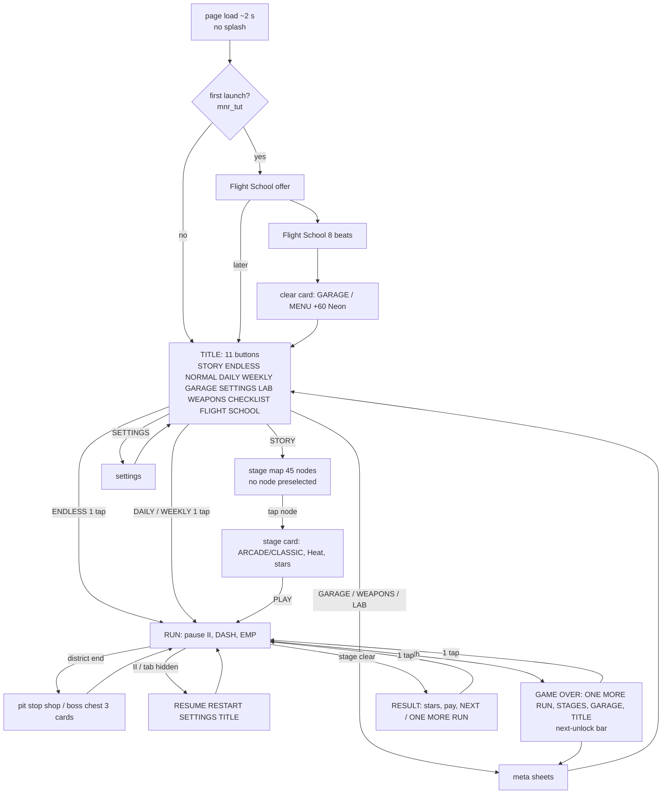

# Nightrun polish plan: music, fun, professional finish (16 Oct 2026)

A research and planning document. No game code was changed. It follows `RETENTION.md` (B1-B17); the backlog here starts at **B18**.
Done from RETENTION so far (flags in `parts/ret.js`): B1 clear pay, B2 economy, B3 mercy, B4 Arcade cut, B5 ONE MORE RUN, B8 Heat, B11 daily
streak + weekly, and the walls retune. Still open from RETENTION: B6 rank, B7 achievements, B9 boss rush, B10 latency onboarding, B12-B17.

How this was measured:
- Nightrun was audited from the code and with a throwaway headless DOM script. It used Playwright at 390x763 with touch, against the built
  `games/mainhattan-nightrun/index.html`, and read the visible buttons, their sizes and font sizes. No screenshots of our game were taken.
- Reference games: 13 images were viewed. Each was a contact sheet, 900 px wide, of up to 4 public store screenshots (about 38 shots in total),
  from 7 games of the genre. Most showed gameplay HUDs. The only menu screens seen were one stage select, one collection grid and one chest pop-up.
  Results-screen and shop details come from text sources (reviews, guides, wikis). No image was saved to the repo.
- Web sources are listed at the end (URL only, accessed 16 Oct 2026). Rules marked *[rule]* are my own inference where no source was found.

---

## 1. Music plan

### 1.1 What we have (the "treblo" workflow)
- **Treblo** is the owner's AI music generator (treblo.com). The owner prompts an instrumental cue ("Lyrics = None") and gets 2 versions (a/b).
  The owner owns the output (ToS s.8). The sources go to `games-src/nightrun/music-treblo/` (160 kbps mp3). After that:
  1. Pick a or b by ear.
  2. Measure the real `bpm`, `offsetMs` and `gapMs` with `audio-test.js`. The prompted BPM is only a target.
  3. Trim to whole bars and normalise to -18 LUFS, true peak -1.5 dB.
  4. Add an entry to `games/mainhattan-nightrun/music/tracks.json` (the stage key must exist in `DEF_BPM`).
  5. Run `analysis/song-energy.py`, which writes the `SONGM` line (bars + loudness per bar) in `parts/ret.js`.
  6. Point the stage at the song.
- **Engine** (`parts/a.js`):
  - `TR` loads each file once into a blob.
  - `AU` plays it through one of **5 pooled `<audio>` slots** (MediaElementSource, then gain `S.g`, then `fb`, `musv`, `duck`, `cutg`, master and a limiter).
  - `BT` is the beat grid, steered to the element's real position (`strTick`, at most 1-4 ms per 25 ms tick).
  - `AU.switchTo(stage)`/`xfade` change songs on a bar line with a one-bar equal-power crossfade, so the grid never jumps.
  - `AU.intense(on)` lifts the music bus and the synth layer. `isched` adds a synth drum layer under mini-bosses.
  - `duckMusic()` dips the music to 0.7 under big effects.
  - The synth (`AU.mus`) plays when a file is missing.
- **Library today:** 11 songs, about **37 minutes** (menu 2:53, stage1 2:53, stage2 2:50, stage3 3:56, boss 4:45, boss2 3:12, endless 2:59,
  endless2 3:06, athina 4:07, athina2 3:31, boss3 2:47). BPMs: 84-136.
- **The repetition problem:** `story.js:78` gives stages 1-32 (acts I-IV) only `stage1`/`stage2`/`stage3`. That is **3 songs for about 32
  stages**, roughly 1.5-2 h of play: the same 3 songs about 10 times each. Endless loops alternate between `endless` and `endless2`.
  The first district boss has no song of its own (`bossSong`: k=0 gets the drum layer only).

### 1.2 Rules from research
- Loudness:
  - Mobile games sit around -16 to -18 LUFS with true peak <= -1 dBTP (M9, M10, M11). Keep **-18 LUFS**.
  - -14 LUFS is the streaming target and is too hot for a game: it leaves no room for the effects.
  - SFX may peak 3-6 dB above the music short-term *[rule]*.
- Ducking:
  - Duck "a few dB, fast attack, slow release" (M12).
  - Use -3 dB for big hits and -6 dB for boss warnings, with a 20-50 ms attack and 300-600 ms release. Never duck per shot *[rule]*.
  - Ours is -3 dB (0.7), which fits. The shot SFX already have a 160 ms gap (`SFXGAP`).
- Vertical layering:
  - Stems share one timeline and all keep running. Muted ones stay in sync (M2, M4).
  - Start with a base plus one intensity layer driven by one parameter (M1).
  - A rhythm shooter splits each song into layers by performance, with the top layer only at the highest multiplier (M14).
  - Layers fade in on a bar and drop within about 1 beat on a hit, coming back on the next bar *[rule]*.
- Horizontal re-sequencing:
  - Swap sections only on phrase or bar boundaries, otherwise the cuts sound sharp (M1, M3).
  - A boss is intro, then phase A loop, a transition, phase B loop, then a finale (M13).
- Sync in Web Audio:
  - Schedule on `AudioContext.currentTime`, with a 25 ms timer and 100 ms lookahead (M6).
  - Several sources only stay sample-locked if they are AudioBufferSourceNodes started at the same context time.
  - Several `<audio>` elements drift a little each (our steering corrects one element per slot).
- MP3 looping:
  - Encoder padding is 576 or 1152 samples plus 529 decoder delay (M7, M8).
  - Firefox trims it from the LAME tag (M16). Chrome and Safari are not confirmed. Our `gapMs` measurement already covers looping `<audio>`.
- Music fatigue:
  - No source gives "minutes of music per 10 h game". Players complain when 2-4 songs repeat for hours (M15).
  - *[Rule]* For 10 h of play, aim for at least 25-30 distinct minutes in rotation, at least 3 songs per district, never the same song twice in
    a row, and a unique theme per boss.

### 1.3 Track list to make (16 tracks + 10 stingers)
- Prompts follow the treblo house style: instrumental, no vocals, no artist names, loopable, whole bars, a clear kick on every beat for the
  first 4 bars (this makes `offsetMs` easy to measure), and no tempo change.
- BPMs climb by district so the game feels faster as you go (the ±80 ms PERFECT window is easiest at 110-135 bpm).
- Each prompt below is the tail added to this **common prefix**: "Instrumental synthwave/cyberpunk game soundtrack, no vocals, no spoken
  words, steady tempo, strong kick on every beat from the first bar, 4/4, ends on a whole bar so it loops cleanly, mixed for a phone game."

| key (tracks.json) | district / use | bpm | mood | length | prompt tail |
|---|---|---|---|---|---|
| `d1a` | Bankenviertel (act I) | 118 | sleek, glassy, confident | 3:00 | "Glossy bank-tower nightlife, plucked arps, warm bass, clean claps, hopeful minor key (A minor), 8-bar intro then 16-bar sections." |
| `d1b` | Bankenviertel alt | 120 | tense | 3:00 | "Cold corporate pursuit, ticking hi-hats, pulsing saw bass, glassy bell lead, E minor, builds every 16 bars." |
| `d2a` | Mainufer (act II) | 124 | wet, flowing | 3:00 | "Rain on a river at night, rolling bassline, wide pads, splashy percussion, D minor, a breakdown at bar 48 then a big return." |
| `d2b` | Mainufer alt | 124 | chase | 3:00 | "Speedboat chase on a neon river, driving 16th bass, metallic toms, siren-like synth lead, D minor." |
| `d3a` | Ostend (act III) | 128 | industrial, cold | 3:00 | "Industrial cyber zone, distorted kick, gated noise snare, robotic arpeggio, F minor, menacing but danceable." |
| `d3b` | Ostend alt | 128 | glitchy | 3:00 | "Data heist, glitch stutters on bar ends, acid bassline, crisp claps, F minor." |
| `d4a` | Messe (act IV) | 132 | grand, crowded | 3:00 | "Huge trade-fair hall turned battlefield, brass-like synth stabs, marching snare rolls, G minor, triumphant chorus every 32 bars." |
| `d4b` | Messe alt | 132 | frantic | 3:00 | "Rush hour panic, fast arps, sidechained pads, punchy drums, G minor." |
| `boss-d1` | SEK-ADLER (act I boss, today only a drum layer) | 120 | heroic threat | 2:30 | "Police interceptor duel, sirens as synth leads, heavy drums, A minor. Sections: 8-bar intro, 32-bar phase A, 4-bar break with a riser, 32-bar phase B (more intense, same key), 8-bar outro." |
| `boss-d2` | FLUSSKRAKE (act II boss) | 124 | heavy, aquatic | 2:30 | same 5-part structure, "deep sub bass, tentacle-like wobbles, D minor" |
| `boss-d3` | ZENTRAL-ICE (act III boss) | 128 | digital menace | 2:30 | same structure, "cold digital choir pads without words, bit-crushed lead, F minor" |
| `boss-d4` | MESSE-WAECHTER (act IV boss) | 132 | mechanical | 2:30 | same structure, "clanking metal percussion, hammer hits on beats 1 and 3, G minor" |
| `pit` | pit stop / garage / shop loop | 100 | calm, cosy | 1:30 | "Relaxed garage workshop at 2 a.m., soft lo-fi drums, warm Rhodes, gentle bass, C major, seamless loop." |
| `school` | flight school tutorial | 110 | friendly, clear | 2:00 | "Friendly training sim, very clear kick and clap on every beat, simple bright arp, C major, nothing busy." |
| `endless3` | endless loop 3+ | 134 | relentless | 3:00 | "Night highway at full speed, driving bass, euphoric lead after bar 32, B minor." |
| `fever` | 8-bar FEVER layer (B21) | song bpm | euphoric | 8 bars, 3 versions | "8-bar euphoric drop loop, huge supersaw chords, four-on-the-floor; make it at 120, 128 and 132 bpm." |

Stingers (one-shots, under 2 s, dry, in A minor or keyless):
- `st-tierup1`..`st-tierup3`: rising sweep plus a chord hit.
- `st-perfect`: a short glassy tick.
- `st-clear`: a 4-chord victory flourish.
- `st-fail`: a falling filter "power down".
- `st-boss-in`: a siren hit with a low boom.
- `st-phase`: reversed cymbal into an impact.
- `st-unlock`: a coin and synth bell.
- `st-newbest`: an arpeggio up.

Total new music: about **41 min** of songs, plus about 0.5 min of stingers. The library goes from 37 to about 78 min, enough for 3 songs per district
and a unique theme per boss. The JSON slots for all of these are in
`games-src/next-wave/music/mainhattan-nightrun/cues-polish.json` (same format as other games' `cues-*.json`; 2 versions a/b each).

### 1.4 Layering spec: practical on our engine
True stems (2-4 synced files per song) are **not** the first step:
- Treblo gives one stereo mix, not stems.
- 4 extra `<audio>` slots per song would drift against each other (each one is steered on its own) and would starve the 5-slot pool that the
  crossfades need.
- Decoding stems into AudioBuffers was removed on purpose (60-100 MB of PCM, main-thread stalls).

So the plan has three cheap tiers that need no new assets, then horizontal sections, and only then optional stems:

| layer | how (engine) | trigger | asset need |
|---|---|---|---|
| L0 filter base | a `BiquadFilter` lowpass inserted between `musv` and `duck` (the `musv` -> `duck` connection in `AU.init`); at tier 0 it is 2.5 kHz, at tier 1 it is 6 kHz, at tier 2 or more it is fully open (20 kHz), moved with `setTargetAtTime` on the next bar line | combo tier (the game's tier, `T_`) | none |
| L1 synth layer | reuse `isched` (the drum layer) at low gain from tier 2 and full gain at max tier, on the same grid | tier | none |
| L2 hit drop | on a hit: lowpass to 900 Hz over 1/4 beat, and the drum layer off; back on the next bar | `NR.on('hurt')` | none |
| L3 stingers | short decoded AudioBuffers (each stinger under 60 KB, so decoding is fine), scheduled on the next beat (PERFECT) or next bar (tier up, phase), at -3 dB | events | 10 stingers (1.3) |
| L4 boss phases | boss songs with an A/B/break structure; `AU.switchTo('boss-dN:B')` is not needed because the song itself is sectioned: seek inside the same slot is risky, so phase B is cut as its **own file** (`boss-d1b`) and switched with the existing bar-line `xfade` when the boss passes 50% HP | boss HP | cut from each boss track (1 file becomes 2) |
| L5 (later, optional) true stems | only if a stem tool is available: 2 files per song (full + drums-only), both on AudioBufferSource from one decoded pair, for Endless only | tier | stems |

Silence before the drop *[rule]*: at a district boss entry, cut `cutg` to 0 for exactly 1 beat before the boss bar (the Drop power-up already
uses `cutg`). Mute the shot SFX for that beat too, then slam back in with `st-boss-in` on beat 1.

### 1.5 Implementation plan (who touches what)
1. Wire the new songs (B18):
   - `tracks.json` entries and `DEF_BPM` keys.
   - `SONGM` regenerated.
   - `story.js:78` picks from a per-district pool `DPOOL[di]` (3 songs, no repeat of the last song played).
   - `songFor` (b.js:105) picks the Endless pool by loop.
   - `bossSong` maps every district boss.
   - Until the files exist, the pools just contain the existing keys (placeholders), so the code ships first.
2. Filter and drum layering plus the hit drop (B19).
3. Stingers (B20).
4. Boss phase music plus silence before the drop (B22).
5. Jukebox (B23).

Feasibility notes:
- Everything stays inside `AU` (a.js), so the flag-guarded lines go in a.js itself (the guard forbids re-defining `AU` methods in another part).
- Hooks use `NR.on`.
- The `xfade` path is already tested by `NR.sw` logs and `audio-test.js`.
- More songs means more `slotFor` evictions. Keep `TR.keepFn` holding only the current and next song.

### 1.6 Measurement checklist (every new track)
1. Decode the length: `ffprobe` duration ≈ bars × 4 × 60 / bpm, to within 30 ms after trimming.
2. Measure `bpm` and `offsetMs` with `audio-test.js` (onset alignment). Reject the track if the BPM drifts more than 0.3% between the first and
   last 16 bars.
3. Measure `gapMs` with `audio-test.js` (the looping `<audio>` gap), which must be under 40 ms.
4. Loudness: ffmpeg `loudnorm` integrated -18 ±1 LUFS, true peak <= -1.5 dBTP, LRA under 12.
5. Energy: `song-energy.py` gives `SONGM.e`. Check that it has at least one calm stretch (a run of 0-3 values) for the director's breather and
   no 16-bar flat line.
6. Drop test: run `sweep.js ONLY=beat` with the song, and check that beat judging stays within ±80 ms.
7. Log the licence line in `music-treblo/README.md` (treblo, the owner's account, no artist names in the prompt).

---

## 2. Fun ideas (ranked by fun per effort)
"Have" means it already exists in Nightrun. Source codes refer to the list at the end.

| # | idea | how it works here | why it's fun (source) | effort | in Nightrun? |
|---|---|---|---|---|---|
| 1 | Music = your combo | tier up opens the filter and adds the drum layer; a hit muffles the song (1.4) | players *hear* their performance (S9, M14) | S | no (only `intense` on bosses) |
| 2 | PERFECT-dash payoff | a PERFECT dash through bullets gives a graze burst, short i-frames and a stinger | rewards the core verb (S9, S23) | S | partly (dash on beat powers up) |
| 3 | Beat-telegraphed boss attacks | every big attack draws a ring that fills over 2 beats and fires exactly on the beat | readable and fair; the rhythm tells you when (S6, S7, S21) | M | partly (WARN lines) |
| 4 | Boss phases change the verb | at 50% the boss gains a new pattern or hazard and its own music section (B22) | avoids the "bigger sponge" (S10, S11) | M | partly (some phases) |
| 5 | FEVER | a full graze meter gives 8 bars of double fire with every layer on, ending in a riser | a peak moment at max combo (S9) | M | no |
| 6 | Risk multiplier | score multiplier grows while no-hit and near enemies, and resets on a hit; shown next to the tier | risky play beats safe play (S3) | S | partly (tier) |
| 7 | Chest reveal as a slot machine | the boss chest's 3 cards flip with a reel spin; the first 3 chests are rigged good | anticipation (S1, S2) | S | partly (3 face-down cards, `shapes.js:30`) |
| 8 | Fusion hint | a glowing "!" on pit-stop cards that would complete a fusion | discovery and build goals (S1, S19) | S | no |
| 9 | Reroll and banish tokens | in the pit stop: 1 reroll and 1 banish per run | agency, a tighter build (S1) | S | reroll yes; banish is RETENTION B12 |
| 10 | Reward cadence 20-30 s | tune the pickups and tier-ups so something good happens every 20-30 s in act I | frequent small rewards (S1) | S | unmeasured |
| 11 | Greedy pickups | a rare big Neon orb spawns inside a bullet lane and expires in 4 beats | risk and reward in positioning (S3, S4) | S | no |
| 12 | Contracts between districts | in the pit stop, take 0-2 curses (faster bullets, no EMP, a dark bar) for +25% Neon each | opt-in difficulty with a reward (S17) | M | no (Heat is per stage) |
| 13 | Local leaderboard + daily seed | daily: the same seed for everyone on this device, a top-10 table per mode with "+1,240 to beat" | a clear target (S14, S15) | S | partly (best score) |
| 14 | Replay ghost | record the ship position per beat (2 bytes × bars); show the best run as a faint ghost on the same stage | learn and chase (S14) | M | no |
| 15 | Weekly mutator | one rule per week (off-beat bullets, double fire rate, mirror) | keeps known enemies fresh (S16, S17) | S | the weekly exists; no mutator |
| 16 | Hazard lanes on the kick | district hazards (river spray, data walls) light up for 1 beat, then hit | readable environment (S6, S7) | M | partly (gates) |
| 17 | Mini-event between acts | a 30-s "radio" interlude: collect notes in a lane, no shooting | variety and a rest beat (S21) | M | no |
| 18 | Wingmen on the off-beat | the crew (`CREW`) fly as wingmen and fire on off-beats | a squad feel (S24) | M | partly (crew perks) |
| 19 | Story stakes cards | a 2-line card at district start and end, and a boss taunt at the phase change, all skippable | purpose for 45 stages (S19) | S | partly (intros) |
| 20 | Assist mode | game speed 70-100%, +2 hull, ±120 ms window; the score is marked ASSIST | access without cheapening ranks (S12, S13) | M | partly (timing window, difficulty) |
| 21 | Grade per section | a letter grade C-S every 16 bars, as a small pop | feedback often (G-type reference) | S | no |
| 22 | Checkpoint rewind in Classic | dying in the last 32 bars once lets you rewind 8 bars (once per stage) | cheap failure (B-type reference) | M | no (mercy instead) |
| 23 | Collection counter | "Fusions found 14/120", "Songs 11/27" | a completion goal (A-type reference) | S | no |
| 24 | Call-and-response boss | the boss plays 2 bars, then goes quiet for 2 bars as a vulnerable window | music as turn-taking (S21, S9) | M | no |
| 25 | Jukebox | unlocked songs in a list, with a pick for Endless | ownership and variety (M15) | S | no |

Fun-per-effort winners: 1, 2, 7, 8, 6, 13, 25, 21 (all S), then 3, 5, 4, 12.

---

## 3. Professional polish checklist
"Top tier" sums up what the genre references and sources do. "Today" is what the code or the headless audit found.

| area | top tier | Nightrun today | gap and fix | size |
|---|---|---|---|---|
| First launch / loading | a branded splash under 2 s, then a playable title | page ready (`html.rdy`) in **1.6-2.4 s** locally; there is no loading indicator before `rdy`, and the title buttons are hidden for up to 6 s if the script is slow | add a thin progress line plus the logo before `rdy`; measure on 4G (budget under 3 s to first tap) | S |
| Title screen | 3-4 big choices, the primary one obvious | **11 buttons** on the title at 390x763 (STORY, ENDLESS, NORMAL, DAILY, WEEKLY, GARAGE, SETTINGS, LAB, WEAPONS, CHECKLIST, FLIGHT SCHOOL); WEEKLY is 97x40 (**under 44 px**) | B25: one big PLAY (continue story) and 3 tiles (Endless, Daily/Weekly, Garage), plus a "more" sheet for Lab, Weapons, Checklist, Flight School and Settings as a cog | M |
| Taps to start | 1-4 taps | **1 tap** Endless; **3 taps** Story (STORY, stage node, PLAY: the next stage is not preselected); first launch +1 (tutorial offer) | preselect the next unbeaten stage so it is 2 taps; CONTINUE on the title makes it 1 tap | S |
| Pause / resume | pause on blur, a 3-2-1 resume on the beat | pause on `visibilitychange` (b.js) and RESUME/RESTART/SETTINGS/TITLE; no count-in | resume with a 1-bar count-in aligned to the grid | S |
| Game over / results | one big retry, the currency earned, a progress bar | ONE MORE RUN (177x44), the next-unlock bar, "Failed runs still pay" (B5): **1 tap** death to next run | add the score count-up, a "new best" stinger and the grade; "New best run" text is **11 px** | S |
| Rewards presentation | a modal, one choice, big animation | the boss chest has 3 face-down cards; Neon is a number | count-up, coin fly to the bank, and stingers (B20) | S |
| Store / garage UX | the balance on every meta screen, compare before you buy | Garage, Weapons, Lab and the pit stop each show the price; the bank is not pinned on every sheet | a pinned bank chip top-right on every meta sheet, plus a +/- stat preview | S |
| Tooltips / help | the first level teaches; nothing else | Flight School (8 beats), a ghost finger, a legend on the title (DRAG/DASH/EMP at **11 px**) | raise the title legend to 13 px or more, or remove it (Flight School covers it) | S |
| Settings | audio sliders, remap, accessibility, language | very good: master/music/effects, ducking, mute, latency test + slider, timing window, beat cue, touch layout, sensitivity, button size, particles, shake, flashing, quality, FPS cap, reduced motion, high-contrast bullets | missing: key remap (desktop), a colour-blind palette, language, game-speed assist | M |
| Error states | a toast if audio or storage fails | the synth plays silently if a song is missing; no message if localStorage is blocked (private mode) | one toast "Progress can't be saved in this browser mode" | S |
| Save safety | cloud or export | **no export/import**; progress lives in about 15 `mnr_*` localStorage keys; iOS can evict storage after 7 days without a visit | B24: EXPORT (copy code/file) and IMPORT in Settings, plus `navigator.storage.persist()` | S |
| Offline / PWA | installable, works offline | **no manifest, no service worker** | B30: manifest, icons, a service worker that caches index + media + music (about 45 MB) | M |
| Performance budget | 60 fps, under 150 MB, under 3 s load | the sweep fails under 45 fps average; `lag-probe.js` exists; no memory budget | add a JS heap check (under 200 MB after 3 stages) to the sweep | S |
| Input latency calibration | first-run tap test | the latency test is in Settings (8 taps, `CAL`); B10 (onboarding) is still open | run it at the end of Flight School (RETENTION B10) | S |
| Haptics | light ticks on PERFECT, heavy on a hit | `navigator.vibrate` only in b.js (hits); iOS Safari has no vibrate | a setting toggle plus PERFECT/tier ticks on Android | S |
| Safe areas | notch-safe HUD | `viewport-fit=cover` and safe-area insets in head.html | keep it: covered by the sweep | ok |
| Portrait / landscape | both | both, with a debounced relayout and `rotate-test.js` | ok | ok |
| SFX / music mix | -18 LUFS music, ducking, no sharp shot spam | -18 LUFS music, a limiter at -4 dB threshold, duck to 0.7, a 160 ms shot gap | a combo-driven music layer (B19); a stinger bus at -3 dB | S |
| Icons and type | one icon family, at least 12 px text | DASH/EMP are icon buttons; **7 texts at 11 px** on the title, map banners at 11 px | lift every text to 12 px or more (13 on phones); check it in the sweep | S |
| Juice | hit-stop, shake, particles, number pops | shake (setting), particles, score pops; **no hit-stop** except the death slow-mo (`G.slow=.3`) | 40-60 ms hit-stop on a boss phase change and a PERFECT dash, behind the reduced-motion setting | S |
| Transitions | 150-250 ms fades between screens | overlays switch `hidden` instantly | a 180 ms fade/slide on `.ov` (CSS only) | S |
| Localization | strings in one table | strings inline in JS/HTML (English plus German place names) | not worth it now; keep new strings in `RET.txt` | L (skip) |
| Achievements / stats | a grid with counters | none (B7 open); no stats screen | B7 plus a STATS tab: playtime, PERFECTs, fusions found x/120, songs x/27 | M |
| Credits / privacy | a credits page, "no data collected" | none in the game | B29: a small CREDITS sheet (music: treblo, owner account; code; "saved only on this device") | S |

---

## 4. Flow maps

### 4.1 References (generic names; from store screenshots and text)
**A. A vampire-survivor-style game.** Cold open to play takes about 4 clicks. Death to next run takes about 4-5.
```
title -> [Start] -> character select -> stage select (+music pick, modifiers, START) -> run (auto-fire, move only)
  -> level-up pick 1 of 3-4 / chest pop-up (OPEN) -> pause -> death or timer -> results (gold, kills, time) -> menu
  -> meta shop (gold) / collection grid "124 of 127" -> character select
```
- HUD: an XP bar across the top with the level at the right; a big timer top-centre; gold and kills top-right; weapon icons top-left.
- The gold balance is shown on every meta screen. START is always a big green button bottom-right, and BACK is a red pill top-right.

**B. A rhythm bullet-hell.** Cold open to play takes about 3-4 taps. Death costs 0 taps (rewind to the checkpoint).
```
title -> modes (story / challenge / playlist / party) -> linear level map -> track (no tutorial) -> 2 hits = shatter
  -> rewind to checkpoint (auto) -> too many -> restart -> level complete -> map -> next track
```
- The whole HUD is one thin progress bar top-centre with checkpoint ticks.
- Strict colours: one danger pink, bright player colours.

**C. A mobile vertical shmup.** Cold open to play takes about 3-4 taps. Death to next run takes about 2-3.
```
title -> campaign map (levels locked by medals) -> hangar (upgrades with stars) -> level -> boss
  -> results (stars, medals) -> hangar (spend, win or lose) -> next/replay
```
- HUD: a big 9-digit score top-centre with a rating word; weapon pips top-left; small round buttons top-right.

**D. A roguelite arena shooter.** Cold open to play takes about 4-5. Death to next run takes about 2-3 (retry with the same setup).
```
title -> character -> starting weapon -> danger level -> wave (20-60 s timer) -> level-up pick -> SHOP (reroll, lock)
  -> ... wave 20 boss -> win/endless or death -> run summary -> retry same / menu
```
- HUD: HP and XP bars plus materials, all top-left; the wave timer big at top-centre; items top-right.

**E. A rhythm roguelite.** Cold open to play takes about 3-4, through a walk-in hub. Death to next run takes about 2-3.
```
title -> hub (walk to shops, characters, zone door) -> floor (move on beat) -> boss -> next zone -> death -> hub
  (keep the premium currency, lose run gold; unlocks by goals)
```
- HUD: a beat bar bottom-centre whose ticks converge on a pulsing heart; equipment slots top-left with input hints.

**F. A twin-stick arcade shooter.** Cold open to play takes about 4. Death to next run is 1 button in under 1 s.
```
title -> adventure map (50 levels, 3 stars, gates every 10) -> drone + super pick -> level -> stars vs target -> next
```
- HUD: score and multiplier top-left; the target score and star bar top-right; flat translucent bars hug the edge.

**G. A rhythm tunnel shooter.** Cold open to play takes about 2-3. Death costs about 0-1 taps (checkpoint).
```
title -> level select -> 5 sections (checkpoint each) -> grade C..S per section -> boss -> next level
```
- No HUD at all: state is shown by track colour and shape.

**Common rules (15):**
1. Title to playing in 4 taps or fewer.
2. Death to next run in 0-2 taps.
3. One currency, pinned on every meta screen.
4. Every run pays.
5. A thin edge HUD over 90%+ of the screen for play.
6. One big number.
7. The goal is visible during the run.
8. Choices are 1 of 3-4 big cards.
9. Fixed spots for START and BACK.
10. Telegraphs before damage.
11. Colour discipline.
12. Feedback in the world.
13. Collection counters.
14. One decision per setup screen, with the last choice remembered.
15. Short levels or checkpoints, with difficulty gated by stars on a map.

Daily/weekly in the references: one fixed seed per day, unlimited retries, a leaderboard (B-, D- and A-type daily variants come from text sources).
No reference uses energy timers.

### 4.2 Nightrun today (from code + the headless audit, 390x763)

Measured numbers:
- Cold open to playing:
  - Endless/Daily: **1 tap**.
  - Story: **3 taps**.
  - First launch: offer + 1 (or the 8-beat tutorial).
- Death to next run: **1 tap** (ONE MORE RUN). Stage clear to the next stage: 1 tap.

Friction points:
1. **11 buttons on the title**, versus 3-5 in every reference. Choice overload for new players, and NORMAL (difficulty) sits among the modes.
2. **Story takes 3 taps and the next stage is not preselected.** The map opens on 45 nodes with no "you are here" card.
3. **WEEKLY is 40 px tall** (under the 44 px rule), and **7 title texts are 11 px**, as are the map banners (`map.js:98,100`).
4. **Duplicated entries:** WEAPONS is a title button and also a Garage tab, and LAB, GARAGE and CHECKLIST are separate doors to meta.
   CHECKLIST (3) is unclear: it doesn't say what it lists.
5. **No CONTINUE:** a returning player has to remember the stage. There is no "last played" memory on the title.
6. No splash or progress before `rdy`. On slow 4G the title buttons can stay invisible (up to 6 s fallback) with no sign of life.
7. Overlays switch instantly (no transitions), and the bank is not pinned on all meta sheets.
8. No save export: losing the browser data loses 10 h of progress (iOS 7-day eviction of script-written storage).

---

## 5. Backlog B18+ (ready worker briefs)
Common rules (the same as RETENTION.md, plus these):
- Build with `python3 games-src/nightrun/parts/build.py`. Run `sweep.js` (full), `rotate-test.js`, `afk-test.js`, `balance-test.js`,
  `audio-test.js` (music items), `python3 games-src/scripts/guard.py` and `stamp-copyright.py`.
- Each item has a flag `RET.<name>` declared in `parts/ret.js` (`if(RET.x===undefined)RET.x=true;`). With the flag off, the game is unchanged.
- **Guard:** never re-define another part's function (for example `AU.*`, `SH.volley`, `ST.finish`) from a new file. Hook with `NR.on(...)`
  or add a flag-guarded line in the owner file (`a.js` for `AU`, `story.js` for `ST`).
- Never touch the `DMG` caps, the entry grace, the on-screen floor or the anti-idle beam (`b.js`). Idle ship: a ship that doesn't move must
  still die (`afk-test.js`).
- Headless checks only, no screenshots. Use the build-tier helper model. One fixer, one round, report in 150 words or less.
- Asset items ship with placeholders first (existing songs and synth one-shots). The owner supplies the files later
  (`next-wave/music/mainhattan-nightrun/cues-polish.json`).

**B18. District song pools + all bosses get a theme** (S, flag `RET.dpool`, order 1, deps none; fun + hours: kills the "3 songs for 32 stages" repetition)
- Deliverable: per-district pools `DPOOL` for the story and the Endless loop. A stage takes the next pool song that is not the last one played,
  and every district boss maps to its own key.
- Placeholders for now:
  - The pools hold the existing keys: d1 = `[stage1,stage2,stage3]`, d2 = `[stage2,stage3,endless]`, d3 = `[stage3,endless,endless2]`,
    d4 = `[endless2,stage1,stage2]`.
  - Bosses use `boss`, `boss2` and `boss3`.
  - The new keys (`d1a`..`boss-d4`) go into `DEF_BPM` and are used automatically once their file appears in `tracks.json`.
- Files: `story.js:78` (`d.song`), `b.js:101-105` (`bossSong`, `songFor`), `a.js` `DEF_BPM`, `ret.js` (`DPOOL`).
- Tests: in a new `polish-test.js`, play stages 1-32 in sim and check that no song plays twice in a row, at least 3 distinct songs per act,
  and `NR.sw` switches on whole bars.
- Risks:
  - The director's length depends on `songBars`; `stLen` must read the chosen song (store it on the stage at `begin()`).
  - The walls tuning (`RET.wallKill`) assumes the old song lengths, so re-run `balance-test.js`.

**B19. Combo-driven music (filter layer + drum layer + hit drop)** (S, flag `RET.layers`, order 2, deps none; fun +++, the player hears their tier)
- Deliverable:
  - A lowpass `BiquadFilter` between `musv` and `duck` (`AU.init`): tier 0 at 2.5 kHz, tier 1 at 6 kHz, tier 2 or more open. Changes happen
    on the next bar line.
  - The `isched` drum layer runs at 0.5 gain from tier 2 and 1.0 at max tier.
  - On a hit, the filter goes to 900 Hz over 1/4 beat and comes back on the next bar.
  - The reduced-motion setting does not affect it, but a new setting "Music reacts: on/off" does.
- Files: `a.js` (`AU.init`, `intense`, `isched`, a new `AU.tier(t)`), with a flag-guarded line where the tier changes (`T_` in b.js), plus
  `NR.on('hurt')`.
- Tests:
  - `polish-test.js` reads `AU.lp.frequency.value` after a forced tier 0, 2 and a hit, and checks that each change is scheduled on a bar line
    (±10 ms).
  - `audio-test.js` beat drift stays within ±80 ms.
  - The sweep shows no new page errors.
- Risks: the filter adds 0 latency (a biquad). The synth fallback (`AU.mus`) must also go through the filter.

**B20. Stingers on the beat** (S, flag `RET.sting`, order 3, deps none, assets: 10 stingers (placeholders are synth one-shots); fun + professionalism)
- Deliverable:
  - `AU.sting(name)` plays a short decoded buffer, quantised to the next beat (`perfect`) or the next bar (`tierup1-3`, `phase`, `boss-in`,
    `clear`, `fail`, `unlock`, `newbest`), at -3 dB on the sfx bus.
  - Until the files exist, `AU.sfx` synth substitutes are used.
  - At most one stinger per beat.
- Files:
  - `a.js` (`AU.sting`, a loader for `music/st-*.mp3` via `fetch` + `decodeAudioData`, each file under 60 KB).
  - Hooks in `ret.js` on `NR.on('tier')`, `'stageClear'`, `'runEnd'` and the boss events. Add a `NR.emit('tier')` line in b.js if it is missing.
- Tests:
  - `polish-test.js` records `AU.sting` calls with their scheduled time and checks the scheduled time `% spb` = grid ±5 ms.
  - Missing files do not throw.

**B21. FEVER (graze meter → 8 bars of everything)** (M, flag `RET.fever`, order 6, deps B19, assets: `fever` loop optional; fun +++)
- Deliverable:
  - A graze meter fills from grazes (one count per frame, as in source S4) and from PERFECT dashes.
  - When it is full, the next bar starts FEVER for 8 bars: the filter opens, the drums go to full, fire rate is doubled, and a gold edge glow
    shows. It ends on a bar.
  - The meter appears as a thin arc around the ship (no new text).
- Files: `ret.js` (meter + state), a guarded line in `b.js` graze code, and the fire-rate multiplier in `g.js` via a flag-guarded factor.
- Tests:
  - The sim forces the meter to full and checks FEVER starts on a bar and lasts 8 bars ±1 beat, and the damage per second goes up by 2x or less.
  - `balance-test.js` passes.
  - An idle ship gets no FEVER, because grazing needs movement.
- Risks: balance. Cap FEVER at once per 32 bars, and never during boss armour floors.

**B22. Boss phases with music sections + silence before the drop** (M, flag `RET.bossph`, order 7, deps B18 B20, assets: `boss-dN` (+ `boss-dNb` phase-B cut); fun ++)
- Deliverable:
  - At boss entry, cut `cutg` to 0 for 1 beat before the boss bar, mute the shot SFX for that beat, then play `st-boss-in` on beat 1.
  - At 50% HP: switch (`AU.switchTo`) to the boss's phase-B key on the next bar, add one new attack pattern per boss (from its existing set,
    not more HP), and do a 50 ms hit-stop.
  - Placeholder phase B: the same song with `AU.intense(true)`.
- Files: `b.js:179` (boss start) and the boss HP check (flag-guarded lines), `a.js` (a cut helper).
- Tests: in sim, kill each district boss and check the phase switch lands on a whole bar (`NR.sw`), the boss stays at 45 s or more, and the
  `DMG` caps are unchanged.
- Risks: boss armour floors (`b.floor`, `minBar`) must still hold.

**B23. Jukebox + song unlocks** (S, flag `RET.juke`, order 9, deps B18; fun + hours (collection))
- Deliverable:
  - A SONGS tab in the Garage lists every `tracks.json` song: title, district, bpm and a lock with the condition ("Beat FLUSSKRAKE").
  - Tap to preview (the menu slot).
  - In Endless, a pin: "play this song first".
  - A counter "Songs 11/27".
  - Unlocking a song plays `st-unlock` and shows a toast.
- Files: `garage.js` (the tab bar, via `ret.js` `NR.on('garageOpen')` if that event exists, or a guarded line), `ret.js`.
- Tests: preview starts and stops the menu slot, there are no slot leaks (5 slots), and the pin makes Endless start on that song.

**B24. Save export / import + persistent storage** (S, flag `RET.saveio`, order 4, deps none; professionalism +++, protects 10 h of progress)
- Deliverable:
  - In Settings, EXPORT copies a base64 code of all `mnr_*` keys (with a checksum) to the clipboard and offers a `.txt` download.
  - IMPORT pastes a code; it is validated, then confirmed with "Replace progress?".
  - Call `navigator.storage.persist()` on first launch.
  - Show a toast if localStorage is unavailable.
- Files: `c.js` (settings rows, around line 161: a new `{g:'Save'}` group), `ret.js`.
- Tests: export, then clear storage, then import, and check every `mnr_*` key is identical. A corrupt code is rejected without changing
  anything. The buttons are at least 44 px.

**B25. Title diet + CONTINUE** (M, flag `RET.title`, order 5, deps none; professionalism +++: taps 3→1 for Story)
- Deliverable:
  - Title: one big **CONTINUE · Stage n NAME** button, which plays the next unbeaten stage with the last Arcade/Classic choice.
  - 3 tiles: ENDLESS, DAILY (with the weekly badge), GARAGE.
  - A cog for SETTINGS and a "MORE" sheet for Story map, Lab, Weapons, Checklist, Flight School and difficulty.
  - The map opens with the next stage card already open.
- Files: `head.html` (the title row), and the buttons that other parts inject (`storyBtn` story.js, `gaBtn` garage.js, `labBtn` lab.js,
  `wpBtn` g.js, `tutBtn` tut.js, `wkBtn`/`dailyBtn` ret.js): each part's injection line gets a flag-guarded target (`RET.title?moreSheet:titleRow`).
- Tests:
  - At 390x763 and 375x553: at most 5 visible title buttons, all at least 44 px.
  - Cold open to a story run in 1 tap.
  - The sweep's title checks are updated (ids are kept).
  - `tutorial-test.js` still passes.
- Risks: the sweep and tests look for these ids, so keep the ids and only move the elements.

**B26. Text size and touch-target floor** (S, flag `RET.type`, order 8, deps B25; professionalism +)
- Deliverable:
  - Every visible text is 12 px or more (13 px on phones under 400 px wide), and every button is at least 44x44.
  - Fix WEEKLY (40 px), the title legend (11 px), the map banners (`map.js:98,100`), "New best run" and "Stage n failed" (11 px).
  - Add a check to `sweep.js`: it fails on visible text under 12 px or a button under 44 px.
- Files: `head.html`, `map.js:98-100`, `ret.js` (`.retBar` already uses a clamp), `sweep.js`.
- Tests: the new sweep check passes at both phone sizes.

**B27. Screen transitions + bank chip + score count-up** (S, flag `RET.trans`, order 10, deps none; professionalism ++)
- Deliverable:
  - `.ov` overlays fade and slide in over 180 ms (none with reduced motion).
  - A pinned Neon chip top-right on every meta sheet (Garage, Weapons, Lab, pit stop).
  - Results count up the score and Neon over 0.8 s (a tap skips it).
- Files: CSS in `ret.js`, `NR.on('runEnd')`.
- Tests: the sweep's "button responds" timing still holds (buttons are tappable 200 ms or less after showing). No covered buttons.

**B28. Hit-stop and PERFECT juice** (S, flag `RET.juice`, order 11, deps B20; fun +)
- Deliverable:
  - A 45 ms hit-stop (`G.slow` dip) on boss phase change, boss kill and PERFECT dash through bullets.
  - A ring flash plus the `perfect` stinger.
  - Haptics: on Android, 8 ms on PERFECT and 25 ms on a hit, with a new setting "Vibration".
  - All of it is off under reduced motion.
- Files: `b.js` (dash judge, guarded line), `c.js` settings row.
- Tests: in sim, the beat grid is unaffected (the hit-stop scales `sdt`, not the audio clock), the beat judging stays within ±80 ms, and
  there is no stall over 8 s.

**B29. Credits + privacy + stats sheet** (S, flag `RET.about`, order 12, deps none; professionalism +)
- Deliverable:
  - An ABOUT sheet (from the cog): credits (music made with treblo by the owner, code and art, the generic tool list), privacy ("no
    accounts, no tracking, saved only on this device"), and the version and build date.
  - A STATS block: playtime, runs, PERFECTs, bosses, fusions found x/120, songs x/N.
- Files: `ret.js`, plus counters on `NR.on` events.
- Tests: the counters increase in sim. No original game, publisher or designer name appears (grep in the test).

**B30. Installable PWA + offline cache** (M, flag `RET.pwa`, order 13, deps B24; professionalism ++, sessions on the go)
- Deliverable:
  - `manifest.webmanifest` (name, icons 192/512 from the title art, `display: fullscreen`, portrait-primary).
  - `sw.js` with cache-first for `index.html`, `media/*` and `music/*`, versioned by build hash.
  - An "Install" item in MORE (on `beforeinstallprompt`).
- Files: new `games/mainhattan-nightrun/manifest.webmanifest` + `sw.js` (built from `parts/` by `build.py`), and the head.html link.
- Tests:
  - Playwright offline: load once, `context.setOffline(true)`, reload, and check the title is ready in under 3 s.
  - The music still plays from the cache.
  - The sweep passes.
- Risks:
  - A stale cache after a deploy: the SW must check the version and update on the next launch.
  - Keep `tracks.json` network-first.

**B31. Local leaderboard + replay ghost** (M, flag `RET.ghost`, order 14, deps none; fun ++ hours +)
- Deliverable:
  - A top-10 table per mode (Endless, Daily, each stage in Arcade), with the date and ship.
  - The result shows "#3 · +1,240 to #2".
  - Ghost: record the ship x/y every beat (as Int16, about 1 KB per 3 min) for the best run of each stage, and draw it as a 30% alpha
    silhouette when replaying that stage. It is off in the Daily.
- Files: `ret.js` (store `mnr_lb`, `mnr_gh_<n>`), and the draw hook in `draw.js` via `NR.on('draw')` or a guarded line.
- Tests: the sim plays stage 1 twice and checks the ghost exists, the table sorts, storage stays under 200 KB, and FPS is unchanged
  (perf-desktop).

**B32. Contracts between districts** (M, flag `RET.contract`, order 15, deps none; fun ++)
- Deliverable:
  - In the pit stop, an optional row of 3 curse cards (bullets +15% speed, no EMP, dark bar every 8 bars, half pickups).
  - Each card taken adds +25% Neon for the rest of the run. At most 2.
  - A shown total: "Neon ×1.5".
- Files: `shop.js` pit panel (a guarded line), and `ret.js` modifiers read by `dir.js`/`b.js` through flag-guarded factors.
- Tests:
  - The sim takes 2 contracts and checks bullet speed ×1.15 and Neon ×1.5, the DMG caps are unchanged, and the entry grace is unchanged.
  - The bot's win rate on stage 8 with contracts is at least 30% (not an unfair wall).

**B33. Chest reveal + fusion hint + greedy orb** (S, flag `RET.loot`, order 16, deps B20; fun ++)
- Deliverable:
  - The boss chest's 3 cards flip in sequence with a reel tick on each beat, and the first 3 chests ever are weighted towards rare.
  - Pit-stop cards that would complete a fusion get a glowing "!".
  - A rare Neon orb (×5) spawns inside a bullet lane and expires in 4 beats.
- Files: `shapes.js:30` (the chest, guarded lines), `shop.js` cards, `ret.js` orb.
- Tests: the sim opens chests 1-3 and checks rarity, the "!" shows exactly when `WP.fu()` has a result, and an AFK ship never collects the orb.

**B34. Story stakes cards + boss taunts** (S, flag `RET.stakes`, order 17, deps B22; fun + (purpose))
- Deliverable:
  - A 2-line card at each district start (who, what is at stake) and a 1-line boss taunt at the phase change. Each line is 8 words or fewer.
  - The cards are skippable by tap, and auto-dismiss in 2 bars.
  - The text comes from STORY.md.
- Files: `story.js` `begin()` (guarded), `ret.js` text table.
- Tests: the sweep's message length check (8 words or fewer), and nothing is covered.

**B35. Assist mode** (M, flag `RET.assist`, order 18, deps none; professionalism + accessibility)
- Deliverable:
  - Settings > Accessibility: "Assist" with game speed 70/85/100% (`NR.music.rate` stays 1; the world `sdt` slows and the beat grid stays),
    +2 hull, and a ±120 ms window.
  - Assist runs are marked ⓐ and do not count for the daily/weekly best or the leaderboard.
- Files: `c.js` settings, `b.js` `sdt` factor (guarded), `ret.js`.
- Tests: speed 70% scales enemy speed by 0.7 ±0.02 while the beat judging still matches the audio, and the daily best ignores assist runs.
- Risks: the music must not be slowed (`NR.music.rate` is locked at 1), so slow only the world.

**B36. Grade pops per 16 bars** (S, flag `RET.grade`, order 19, deps none; fun +)
- Deliverable:
  - Every 16 bars, a letter (C/B/A/S) pops where the ship is, from the PERFECT ratio and hits in those bars.
  - An S plays `st-tierup1`.
  - The result shows the grades as a strip.
- Files: `ret.js` (`NR.on('bar')` or the director's bar tick in `dir.js` via a guarded emit).
- Tests: in sim, a perfect bot gets S and an idle bot gets C, and the pop never covers buttons.

**Dispatch:**
- **Wave 1 (two build-tier workers):** B18+B19+B20 (music, owner of `a.js`) and B24+B25+B26 (save + title + type).
- **Wave 2:** B21+B22+B28 (fever, bosses, juice), then B23, B27, B29, B30, B31-B36.

**Owner assets** (next-wave slots in `games-src/next-wave/music/mainhattan-nightrun/cues-polish.json`):
- 15 treblo songs: `d1a`..`d4b`, `boss-d1`..`boss-d4`, `pit`, `school`, `endless3`.
- 3 fever loops.
- 10 stingers.
- Each needs 2 versions (a/b).
- Art: PWA icons 192/512 (cut from `media/title.webp`, no new painting needed).

---

## Sources (accessed 16 Oct 2026, URL only)
Music:
- M1 https://alibimusic.com/blog/adaptive-music-video-games
- M2 https://sounddesign.irpr.agency/glossary/vertical-layering/
- M3 https://sounddesign.irpr.agency/glossary/horizontal-resequencing/
- M4 https://gamedeveloper.com/audio/composer-guy-jones-talks-adaptive-music-for-games
- M5 https://www.abratabia.com/web-game-audio/dynamic-game-music.php
- M6 https://web.dev/articles/audio-scheduling
- M7 https://compuphase.com/mp3/mp3loops.htm
- M8 https://github.com/google/WebFundamentals/pull/4121/files
- M9 https://www.audiogang.org/wp-content/uploads/2015/04/IESD-Mix-Ref-Levels-v03.02.pdf
- M10 https://audiokinetic.com/ko/blog/mastering-a-game-with-wwise-part1 (snippet only)
- M11 https://designingsound.org/2013/02/20/different-loudness-ranges-for-console-and-mobile-games
- M12 https://bugnet.io/blog/how-to-mix-game-audio-so-nothing-drowns-out
- M13 https://etheses.whiterose.ac.uk/27365/
- M14 https://pr.funcom.com/Funcom-Releases-Gameplay-Music-Video-for-Rhythm-FPS-Metal-Hellsinger
- M15 https://world.hey.com/thome/game-101-reducing-music-fatigue-d0214e31 (snippet only)
- M16 https://bugzilla.mozilla.org/show_bug.cgi?id=1566389

Fun:
- S1 https://jboger.substack.com/p/the-secret-sauce-of-vampire-survivors
- S2 https://researchportal.port.ac.uk/en/publications/vampire-survivors-how-developers-used-gambling-psychology-to-crea/
- S3 https://itch.io/post/7771124
- S4 https://shmups.system11.org/viewtopic.php?p=854234
- S5 https://store.steampowered.com/app/3560690/Astro_Fighters/
- S6 https://www.indiedb.com/news/outerdim-lost-between-dimensions-devlog-7
- S7 https://herwe1ns.itch.io/ternia/devlog/551983/postjamupdate2
- S8 https://cosephgames.itch.io/beathell
- S9 https://www.gamespot.com/articles/in-metal-hellsinger-death-is-your-instrument/1100-6505266/
- S10 https://www.wayline.io/blog/crafting-legendary-boss-battles
- S11 https://www.summerengine.com/ai-bullet-hell-maker.md
- S12 https://deadcells.wiki.gg/wiki/Assist_Mode
- S13 https://www.therookies.co/projects/63141
- S14 https://toucharcade.com/community/threads/arcane-tower-by-diego-cathalifaud.266385/
- S15 https://crowbarska.itch.io/deathball/devlog/192832/update-017-daily-challenge-mode-more
- S16 https://www.newworld.com/news/articles/behind-the-scenes-expedition-mutators
- S17 https://game-wisdom.com/?p=24881
- S18 https://choostgames.com/blog/bullet-hell-subgenres-guide/
- S19 https://www.feedme.design/why-we-cant-stop-playing-these-roguelites
- S20 https://gdcvault.com/play/1022120/Level-Up-Your-Game-The (paywalled)
- S21 https://amitaizenman.itch.io/beat-it
- S22 https://giux.itch.io/music-hell/devlog/463902/music-hell-the-ultimate-fusion-of-rhythm-and-bullet-hell-action-is-here
- S23 https://bugnet.io/blog/how-to-design-a-rhythm-game
- S24 https://itch.io/post/12843412

Flow references:
- Store screenshot lists:
  - https://store.steampowered.com/api/appdetails?appids=1794680
  - https://store.steampowered.com/api/appdetails?appids=531510
  - https://store.steampowered.com/api/appdetails?appids=667600
  - https://store.steampowered.com/api/appdetails?appids=1942280
  - https://store.steampowered.com/api/appdetails?appids=247080
  - https://store.steampowered.com/api/appdetails?appids=310790
  - https://store.steampowered.com/api/appdetails?appids=356400
- Text sources:
  - https://www.destructoid.com/a-very-beginners-guide-to-vampire-survivors/
  - https://vampire.survivors.wiki/w/Gold_Coin_(currency)
  - https://nintendolife.com/reviews/switch-eshop/just_shapes_and_beats
  - https://butwhytho.net/2019/02/review-just-shapes-and-beats
  - https://www.trueachievements.com/game/Sky-Force-Reloaded/walkthrough/3
  - https://www.pushsquare.com/reviews/ps4/sky_force_reloaded
  - https://rogueliker.com/brotato-guide/
  - https://earlyguides.com/brotato
  - https://www.windowscentral.com/steam-spotlight-crypt-necrodancer
  - https://giantbomb.com/reviews/geometry-wars-3-dimensions-review
  - https://stevivor.com/reviews/review-geometry-wars-3-dimensions/
  - https://www.nintendolife.com/reviews/switch-eshop/thumper
  - https://thumpergame.com/manual/

Evidence gaps:
- No source gives the minutes of music shipped by 10-hour games.
- Chrome/Safari mp3 padding trimming is unconfirmed (we measure `gapMs` instead).
- Reference results and shop screens come from text, not images.
- Tap counts for the references are estimates.
